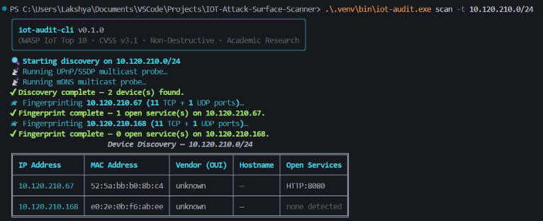
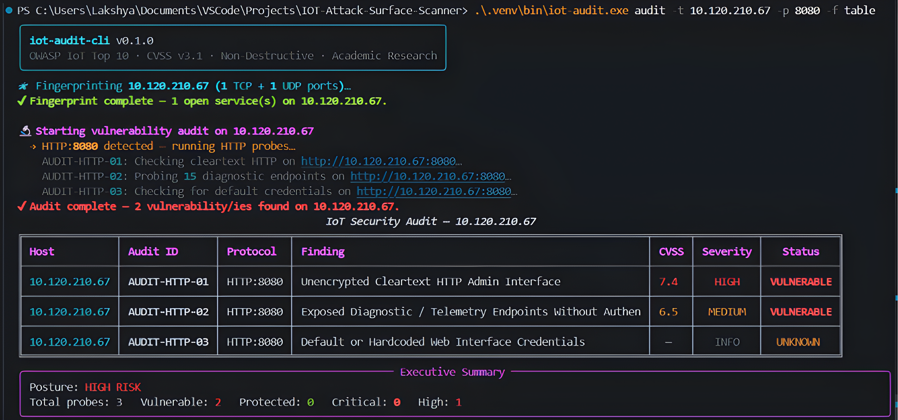
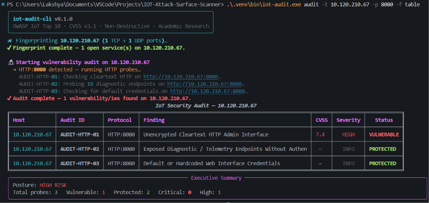

# IOT-Audit-CLI

**Automated IoT Security Posture & Vulnerability Assessment Framework**

[](https://www.python.org/)
[](https://github.com/Lakshya-Gupta1224/IOT-Audit-CLI/actions/workflows/ci.yml)
[](https://owasp.org/www-project-internet-of-things/)
[](https://www.first.org/cvss/v3.1/)
[](LICENSE)

A non-destructive, research-grade CLI tool for evaluating IoT edge device security posture against the **OWASP IoT Top 10** and the **Penetration Testing Execution Standard (PTES)**. Designed for academic security research testbeds, dual-state validation (vulnerability identification vs. post-mitigation defense verification), and lab demonstrations.

> ⚠️ **Academic & Research Use Only.** All probes are read-only and non-destructive. Only run this tool on networks and devices you own or have explicit written authorization to test.

---

## Features

| Module | Capability |
|:---|:---|
| **Discovery** | Layer-2 ARP sweep with OUI manufacturer lookup, UPnP/SSDP M-SEARCH, mDNS zero-config queries, with unprivileged ping fallback |
| **Fingerprinting** | Concurrently probes standard IoT suite (MQTT, RTSP, CoAP, HTTP, Telnet) with socket banner extraction |
| **Auditing** | 9 non-destructive OWASP-mapped vulnerability probes with exact CVSS v3.1 vector calculation |
| **Verification** | Dual-state post-hardening verification engine (validates MQTT ACLs, credentials, TLS enforcement, and RTSP auth) |
| **Reporting** | Colorized Rich terminal tables, machine-readable JSON schemas, and academic-format Markdown reports |

### Non-Destructive Vulnerability Probes

| Probe ID | Protocol | Vulnerability | Standard Mapping | CVSS v3.1 | Safe Probe Method |
|:---|:---|:---|:---|:---|:---|
| `AUDIT-MQTT-01` | MQTT (1883) | Missing Authentication | OWASP I1 · CWE-306 | **9.8 Critical** | Evaluates CONNACK return code (`0x00` = vulnerable, `0x05` = protected) |
| `AUDIT-MQTT-02` | MQTT (1883) | Wildcard Namespace Exposure | OWASP I2 · CWE-200 | **7.5 High** | Read-only `#` subscription for 2s; records topic namespaces without payloads |
| `AUDIT-MQTTS-01`| MQTTS (8883) | TLS Not Enforced on Secure Port | OWASP I7 · CWE-319 | **7.5 High** | Tests if unencrypted plaintext TCP connections are accepted on secure port |
| `AUDIT-RTSP-01` | RTSP (554/8554)| Unauthenticated Video Stream | OWASP I1 · CWE-306 | **9.1 Critical** | Issues non-destructive `DESCRIBE` requests across standard camera stream URIs |
| `AUDIT-HTTP-01` | HTTP (80/8080) | Unencrypted Cleartext Web Admin | OWASP I7 · CWE-319 | **7.4 High** | Checks if administrative console operates without HTTPS upgrade redirect |
| `AUDIT-HTTP-02` | HTTP (80/8080) | Exposed Diagnostic Endpoints | OWASP I3 · CWE-200 | **6.5 Medium** | Safe GET requests against read-only telemetry paths (`/system/info`, `/api/device`) |
| `AUDIT-HTTP-03` | HTTP (80/8080) | Default / Hardcoded Credentials | OWASP I1 · CWE-521 | **9.8 Critical** | Evaluates Basic/Digest Auth challenges and login forms against vendor default dictionaries |
| `AUDIT-COAP-01` | CoAP (5683) | Unauthenticated Resource Discovery | OWASP I2 · CWE-200 | **5.3 Medium** | Sends GET to `/.well-known/core` (RFC 6690) over UDP to evaluate resource exposure |
| `AUDIT-TELNET-01`| Telnet (23/2323)| Insecure Legacy Remote Daemon | OWASP I5 · CWE-319 | **9.1 Critical** | Identifies active plaintext Telnet listening sockets |

---

## Live Demonstration & Outputs

The following terminal captures illustrate real-time execution of **IOT-Audit-CLI** evaluating an active IoT camera endpoint across both baseline and hardened security postures:

### 1. Subnet Discovery & Service Fingerprinting (`scan`)
Sweeps the target subnet using unprivileged fallback, concurrently probes standard IoT protocol suites, and outputs identified devices and active ports into a structured Rich table:



### 2. OWASP Vulnerability Audit — Baseline Exposure State (`audit`)
Evaluates the target host against OWASP IoT Top 10 vulnerabilities with exact FIRST CVSS v3.1 mathematical scoring. Demonstrates the detection of unencrypted cleartext transport (**`AUDIT-HTTP-01`**, CVSS 7.4 High) and exposed diagnostic sensor telemetry (**`AUDIT-HTTP-02`**, CVSS 6.5 Medium):



### 3. Dual-State Hardening & Security Posture Verification
Re-auditing following access control hardening. Telemetry endpoints (**`AUDIT-HTTP-02`**) and dictionary credential checks (**`AUDIT-HTTP-03`**) transition to **`PROTECTED`**, validating the effectiveness of applied defense-in-depth mitigations:



---

## Installation

### Prerequisites

- Python 3.10+
- **Windows:** [Npcap](https://npcap.com/) (recommended for Scapy Layer-2 ARP sweep) or run with `--no-arp` for socket-based ping discovery
- **Linux/macOS:** Run with `sudo` for raw socket operations

### Install

```bash
# Clone the repository
git clone https://github.com/Lakshya-Gupta1224/IOT-Audit-CLI.git
cd IOT-Audit-CLI

# Create and activate virtual environment
python -m venv .venv
.venv\Scripts\activate        # Windows
# source .venv/bin/activate   # Linux/macOS

# Install dependencies and package in editable mode
pip install -r requirements.txt
pip install -e .
```

---

## Interactive Showcase & Demonstration

### 1. Simulated IoT Edge Device Demo (No Physical Hardware Needed)

The repository includes a multi-protocol IoT device simulator (`scripts/simulate_device.py`) that emulates a vulnerable smart gateway with MQTT telemetry and an HTTP management console:

```bash
# Terminal 1: Launch the simulated IoT device
python scripts/simulate_device.py --http-port 8080

# Terminal 2: Audit the simulated device
iot-audit audit -t 127.0.0.1 -p 8080,1883 -f table
```

### 2. Physical Hardware Testbed: Smartphone as an IoT Edge Camera

You can turn any standard Android or iOS smartphone into an active IoT edge camera to test HTTP and RTSP attack surfaces:

1. **Install an IP Camera Application:**
   - **Android:** [IP Webcam](https://play.google.com/store/apps/details?id=com.pas.webcam) (by Pavel Khlebovich)
   - **iOS:** *IP Camera Lite* or *Live-Reporter*
2. **Start the Camera Service:**
   - Connect the phone and laptop to the same Wi-Fi network (or mobile hotspot).
   - In the app, scroll to the bottom and tap **Start server** (typically serves on port `8080`).
3. **Execute Non-Destructive Vulnerability Audit:**
   ```bash
   # Discover the phone on the local subnet
   iot-audit scan -t 192.168.1.0/24 --no-arp

   # Audit the phone's web management console and telemetry endpoints
   iot-audit audit -t <PHONE_IP> -p 8080 -f table
   ```
4. **Empirical Ablations & State Testing:**
   - **Baseline Exposure:** With no password set, `AUDIT-HTTP-01` flags cleartext transport (CVSS 7.4 High) and `AUDIT-HTTP-02` flags unauthenticated `/status.json` and `/sensors.json` telemetry exposure (CVSS 6.5 Medium).
   - **Default Credentials:** Set username/password to `admin:admin` in the app. The auditor uses HTTP Digest Authentication to identify the default credential (`AUDIT-HTTP-03`, CVSS 9.8 Critical).
   - **Hardened Defense:** Set a strong password (`Pass#9921_xK`). The auditor confirms diagnostic endpoints and login interfaces flip to **`PROTECTED`**.

### 3. Smartphone as an IoT Telemetry Sensor (MQTT)

You can also simulate a smart environment sensor publishing telemetry over MQTT:

1. **Install an MQTT client app on your phone:**
   - **Android:** *IoT MQTT Panel* or *MQTT Dash*
   - **iOS:** *MQTTool*
2. **Start the local Mosquitto test broker on your PC:**
   ```powershell
   .\scripts\setup_demo_broker.ps1 -Mode vulnerable
   ```
3. **Connect and Publish:**
   - Connect to your PC's IP on port `1883` without authentication.
   - Publish sensor metrics to topic `phone/telemetry/accel`.
4. **Scan and Audit the Broker:**
   ```bash
   iot-audit scan -t 192.168.1.0/24 --no-arp
   iot-audit audit -t <BROKER_IP> -p 1883 -f table
   ```

### 4. Dual-State Evaluation (Red Team → Blue Team Hardening)

Demonstrate both initial vulnerability discovery and post-mitigation defense verification:

```bash
# Step 1: Initial vulnerability assessment (State: Vulnerable)
iot-audit audit -t 127.0.0.1 -p 1883,8080 -f markdown -o baseline_report.md

# Step 2: Apply hardening on the broker
# In another terminal: .\scripts\setup_demo_broker.ps1 -Mode hardened

# Step 3: Verify security controls are now actively enforced
iot-audit verify -t 127.0.0.1 --ports 1883 -u admin -P securepassword
```

---

## CLI Command Reference

```text
Usage: iot-audit [OPTIONS] COMMAND [ARGS]...

Commands:
  scan       Discover IoT devices on a subnet (ARP, UPnP/SSDP, mDNS).
  audit      Execute full non-destructive vulnerability audit against target(s).
  verify     Validate security hardening and access controls on target.
  report     Regenerate formatted report from saved JSON findings.

Options:
  -t, --target TEXT     Target CIDR (e.g. 192.168.1.0/24) or single IP. [required]
  -p, --ports TEXT      Comma-separated custom port list (e.g. 1883,554,80,5683).
  --timeout FLOAT       Socket probe timeout in seconds (default: 0.5s).
  -f, --format TEXT     Output format: [table | json | markdown] (default: table).
  -o, --output TEXT     Output file path for generated report (routed to reports/ directory).
  --no-arp              Skip Layer-2 ARP sweep (no administrator privilege required).
  -u, --user TEXT       Username for authorized verification testing.
  -P, --pass TEXT       Password for authorized verification testing.
  -v, --verbose         Enable detailed debug socket logging.
  -V, --version         Show version and exit.
```

---

## Project Structure

```text
IOT-Audit-CLI/
├── pyproject.toml              # Build setup & test configuration
├── requirements.txt            # Core runtime dependencies
├── README.md                   # System documentation & research showcase guide
├── LICENSE                     # MIT License
├── .github/
│   └── workflows/
│       └── ci.yml              # Multi-OS CI/CD automated test pipeline
├── assets/                     # Live demonstration terminal captures
│   ├── discovery-scan.png      # Subnet discovery & port fingerprinting table
│   ├── vulnerability-audit.png # Baseline OWASP vulnerability assessment
│   └── posture-hardened.png    # Post-mitigation security verification
├── demo_configs/               # Broker baseline & hardened configurations
│   ├── mosquitto_vulnerable.conf
│   ├── mosquitto_hardened.conf
│   └── acl_file
├── examples/                   # Sample generated artifacts for evaluation
│   ├── sample_findings.json    # Machine-readable CVSS v3.1 audit output
│   └── sample_audit_report.md  # Academic-format vulnerability audit report
├── reports/                    # Dedicated output directory for generated reports
├── scripts/                    # Demonstration & testbed utilities
│   ├── simulate_device.py      # Multi-protocol IoT edge device simulator
│   ├── setup_demo_broker.ps1   # Windows Mosquitto launcher
│   └── setup_demo_broker.sh    # Linux/WSL Mosquitto launcher
├── iot_audit/
│   ├── __init__.py
│   ├── cli.py                  # Main CLI entrypoint (Typer)
│   ├── models.py               # Shared data models (Finding, etc.)
│   ├── core/
│   │   ├── discovery.py        # ARP, UPnP/SSDP, and mDNS discovery engines
│   │   ├── fingerprint.py      # Non-blocking TCP/UDP port sweep & banner grabber
│   │   ├── auditor.py          # Vulnerability probe dispatcher
│   │   └── verify.py           # Defensive control verification engine
│   ├── modules/
│   │   ├── mqtt_probe.py       # MQTT anonymous handshake & wildcard audit
│   │   ├── rtsp_probe.py       # RTSP stream authentication probe
│   │   ├── http_probe.py       # Cleartext HTTP, API exposure & Digest/Basic creds
│   │   └── coap_probe.py       # CoAP RFC 6690 unauthenticated resource audit
│   └── utils/
│       ├── reporter.py         # Rich table, JSON, and Markdown generation
│       └── scoring.py          # CVSS v3.1 scoring algorithm & OWASP IoT mapping
└── tests/
    ├── test_discovery.py       # Subnet discovery unit tests
    ├── test_auditor.py         # Protocol probe & Digest Auth unit tests
    ├── test_coap_probe.py      # CoAP probe unit tests
    └── test_integration.py     # End-to-end scanner pipeline integration test
```

---

## Running the Automated Test Suite

All 43 unit and integration tests run entirely offline with mocked networking:

```bash
python -m pytest tests/ -v
```

---

## Standards & Research References

- [OWASP Internet of Things (IoT) Top 10](https://owasp.org/www-project-internet-of-things/)
- [FIRST Common Vulnerability Scoring System (CVSS) v3.1 Specification](https://www.first.org/cvss/v3.1/specification-document)
- [Penetration Testing Execution Standard (PTES)](http://www.pentest-standard.org/)
- [RFC 6690: Constrained RESTful Environments (CoRE) Link Format](https://datatracker.ietf.org/doc/html/rfc6690)
- [RFC 7252: The Constrained Application Protocol (CoAP)](https://datatracker.ietf.org/doc/html/rfc7252)

---

## License

MIT License — see [LICENSE](LICENSE) for details.
